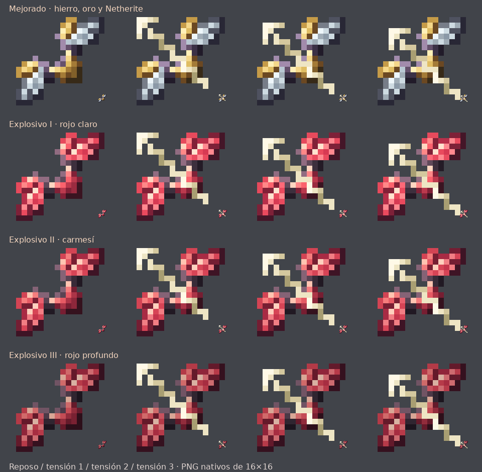

# Arcos nuevos · #83 (26.2)

[Descargar ZIP](arcos-nuevos.zip)

- **Arco Mejorado** (`arco_mejorado`): la misma forma del arco explosivo, con hierro plateado, oro y empuñadura oscura de Netherite, como los materiales de su receta.
- **Arcos Explosivos** (`arco_nivel1`, `arco_nivel2`, `arco_nivel3`): rojos en todos los niveles; rojo más claro para el I, carmesí para el II y rojo profundo para el III.

Cada arco incluye **cuatro PNG RGBA de 16×16**: reposo y tres fases al tensarlo. Se mantiene la silueta y la transparencia exacta de las referencias originales, cambiando únicamente la paleta. Cuerdas y flechas conservan colores claros.

Se incluyen las cuatro definiciones `items/`, sus dieciséis modelos y dieciséis texturas. Los JSON seleccionan las poses con `using_item` y `use_duration`, a los mismos umbrales vanilla de 0,65 y 0,9. Estos recursos también están en `resourcepack/assets`.

## Instalar

Fusiona **assets** con tu resource pack después de los ZIP anteriores y acepta los reemplazos. Conserva tu `pack.mcmeta` y recarga con **F3 + T**. Si distribuyes el pack desde el servidor, actualiza el ZIP y su hash. Los items conservan sus identificadores, así que no necesitas reemplazarlos para ver las texturas nuevas.

Se revisaron los 16 PNG, su transparencia, las referencias entre JSON y texturas y el contenido del ZIP. La vista amplía los PNG reales; no es una captura de Minecraft.
