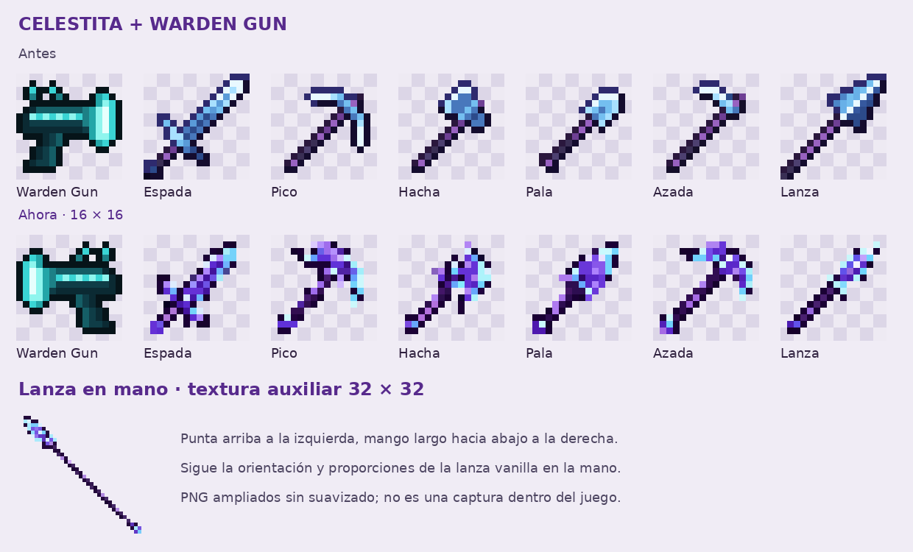

# Celestita y Warden Gun · correcciones

Entrega separada para la rama **26.2**. Incluye los PNG y los JSON necesarios; los originales de `resourcepack/` siguen disponibles para comparar.

## Cambios

- **Warden Gun:** volteo horizontal exacto de la textura original, sin recolorearla ni redibujarla. El cañón queda a la izquierda y la empuñadura a la derecha. Se conservan sus transformaciones de mano.
- **Espada, pico, hacha, pala, azada y lanza de celestita:** nuevas siluetas de cristal, predominio morado y filos celestes. Los siete iconos de inventario son PNG transparentes de **16×16**.
- **Lanza en la mano:** usa una textura adicional **32×32**, `lanza_celestita_in_hand.png`, alargada y orientada desde arriba a la izquierda hacia abajo a la derecha. Es la disposición de las lanzas de Minecraft 26.2. El inventario conserva el icono de 16×16, apuntando hacia arriba a la derecha.

El fallo anterior de la lanza estaba en que `lanza_celestita_in_hand.json` apuntaba al mismo icono corto de inventario. El padre vanilla `minecraft:item/spear_in_hand` espera la otra orientación y proporciones; por eso cambiar solo el PNG de inventario no lo corrige. Este paquete conserva ese padre, la selección por contexto y `swap_animation_scale: 1.95` de las lanzas vanilla.

## Instalación

1. Descarga [el ZIP](celestita-warden.zip) o copia la carpeta `assets` de esta entrega.
2. Fusiona `assets` con la raíz de tu resource pack, reemplazando los archivos coincidentes. Mantén el `pack.mcmeta` de tu pack.
3. Copia también los **JSON**: la lanza necesita la nueva referencia a `lanza_celestita_in_hand`.
4. Recarga el pack con **F3 + T**. Si distribuyes el pack desde el servidor, actualiza también el ZIP y su hash.

No hace falta cambiar los identificadores del plugin: siguen siendo `minecraft:warden_gun`, `minecraft:espada_celestita`, `minecraft:pico_celestita`, `minecraft:hacha_celestita`, `minecraft:pala_celestita`, `minecraft:azada_celestita` y `minecraft:lanza_celestita`.

Este ZIP es un complemento para tu pack, no un pack autónomo. La textura de mano de la lanza es auxiliar; no es otro item de `/giveqp`.

## Revisión de lo que falta

- [Inventario de texturas ya hechas](inventario-texturas.md): 95 nombres distintos de items e iconos, incluidas las monedas y los drops florales de las entregas anteriores.
- [Los 30 siguientes items pendientes](30-items-pendientes.md): nombre visible, clave de `/giveqp` y nombre exacto del modelo. Es un listado de pendientes; sus texturas todavía no se incluyen.

## Comprobaciones

Se comprobaron los tamaños PNG, transparencia, volteo exacto del Warden Gun, referencias de los JSON y contenido del ZIP. La selección y orientación de la lanza se contrastaron con los [assets vanilla de 26.2](https://github.com/misode/mcmeta/tree/26.2-assets/assets/minecraft).

La vista previa muestra los PNG ampliados sin suavizado. No sustituye una comprobación visual dentro del cliente de Minecraft; no se ha ejecutado un cliente para este lote.
