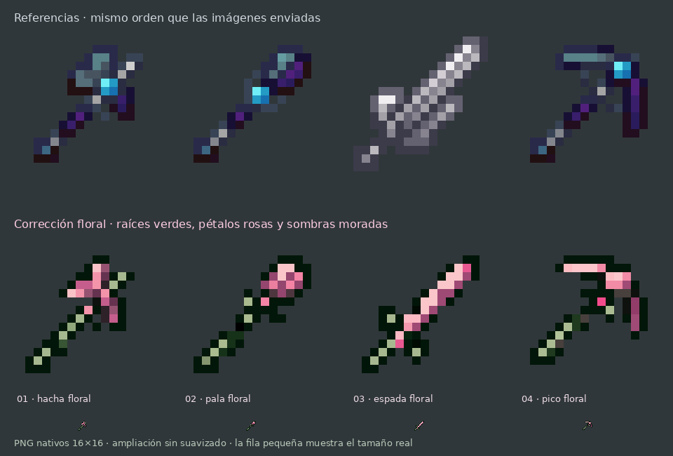

# Corrección de herramientas florales · #73

[Descargar ZIP](correccion-herramientas-florales.zip)

Nueva variante en una subcarpeta independiente, usando las cuatro referencias del usuario. Mantiene el orden **hacha, pala, espada y pico**, los mangos diagonales y las formas de sus cabezas, con pequeños ajustes florales.

Los mangos son raíces verdes oscuras con vetas verde salvia; las cabezas llevan rosas claros y sombras moradas. Pequeños brotes rosas y hojas se concentran en las uniones, con contorno verde casi negro para mantener la lectura del item.

## Archivos sueltos, en orden

1. `01_hacha_floral.png`
2. `02_pala_floral.png`
3. `03_espada_floral.png`
4. `04_pico_floral.png`

Todos son PNG RGBA **16×16 reales**, sin suavizado y con transparencia binaria. Los mismos píxeles están en `assets/minecraft/textures/item/custom/`, con los nombres que ya usa el plugin. Se incluyen los JSON de los cuatro items y sus modelos `item/handheld`.

Las referencias corresponden a `twisted_axe_0`, `twisted_shovel_0`, `pale_sword` y `twisted_pickaxe_0`, incluidas en los archivos de estilo aportados por el usuario. La vista muestra esas referencias arriba y los PNG exportados abajo, conservando su orden.

## Aplicar esta variante

Fusiona la carpeta **assets** del ZIP con tu resource pack, reemplazando las cuatro herramientas. Conserva el `pack.mcmeta` de tu pack y recarga con **F3 + T**. Si distribuyes el pack desde el servidor, actualiza su ZIP y hash.

Esta revisión está solo en esta subcarpeta: puedes compararla con las anteriores antes de integrarla. No modifica los atributos de las herramientas ni requiere recrear los items.

Se verificaron dimensiones, transparencia, nombres de modelo, coincidencia entre los PNG sueltos y los de `assets`, y el contenido del ZIP. La vista es una ampliación de las texturas reales, no una captura del juego.
