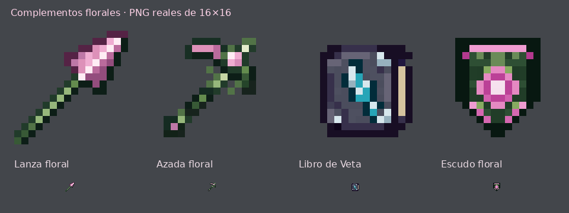

# Herramientas y complementos florales · #79

[Descargar ZIP](correccion-herramientas-florales.zip)

## Lanza, azada, Veta y escudo

- **Lanza floral:** punta rosa con sombras moradas y mango de raíces verdes. Conserva la silueta y el sombreado de la lanza de celestita, cambiando la paleta.
- **Azada floral:** recoloración de `twisted_hoe_0.png`, con exactamente los mismos píxeles opacos y transparentes del original y la paleta de las otras herramientas florales.
- **Libro de Veta:** tapa gris pizarra, esquinas plateadas, páginas crema y una veta cian en el centro, siguiendo el estilo de los libros de encantamientos anteriores.
- **Escudo floral:** cuerpo verde oscuro, borde rosa y una flor central rosa y morada. La textura es simétrica y no tiene huecos interiores. Conserva los modelos de reposo y bloqueo.

Los cuatro iconos son PNG RGBA **16×16 reales**, con transparencia binaria, sin suavizado. Se incluyen sus JSON con los identificadores que ya usa el plugin: `minecraft:lanza_floral`, `minecraft:azada_floral`, `minecraft:libro_veta` y `minecraft:escudo_floral`.

La lanza lleva además una textura **32×32 para la mano**, siguiendo la distribución de la lanza vanilla. Su definición selecciona el icono de 16×16 en inventario/suelo/marco/estante y el modelo `item/spear_in_hand` con su textura correspondiente al equiparla.

## Herramientas de la revisión #76

Las cuatro primeras herramientas conservan exactamente sus referencias: ningún píxel añadido, eliminado o desplazado. Solo cambia la paleta a rosas, morados y verdes. Sus PNG no han cambiado en esta revisión.

## Archivos sueltos, en orden

1. `01_hacha_floral.png`
2. `02_pala_floral.png`
3. `03_espada_floral.png`
4. `04_pico_floral.png`
5. `05_lanza_floral.png`
6. `06_azada_floral.png`
7. `07_libro_veta.png`
8. `08_escudo_floral.png`

Los PNG sueltos son idénticos a sus copias de `assets/minecraft/textures/item/custom/`. Los cuatro recursos nuevos también están integrados en `resourcepack/assets`.

## Instalar

Fusiona la carpeta **assets** del ZIP con tu resource pack, después de los paquetes antiguos, aceptando los reemplazos. Conserva el `pack.mcmeta` de tu pack y recarga con **F3 + T**. Si lo distribuyes desde el servidor, actualiza el ZIP y su hash.

No cambia la lógica del plugin ni requiere recrear objetos. La azada usa `item/handheld`; el escudo mantiene su cambio de pose al bloquear; la lanza conserva los contextos de visualización vanilla.

Se verificaron dimensiones, transparencias, siluetas de las referencias recoloreadas, simetría y ausencia de huecos del escudo, enlaces entre JSON y texturas, igualdad de las copias y contenido del ZIP. Las vistas amplían los PNG finales; queda pendiente comprobar su apariencia en un cliente de Minecraft.
