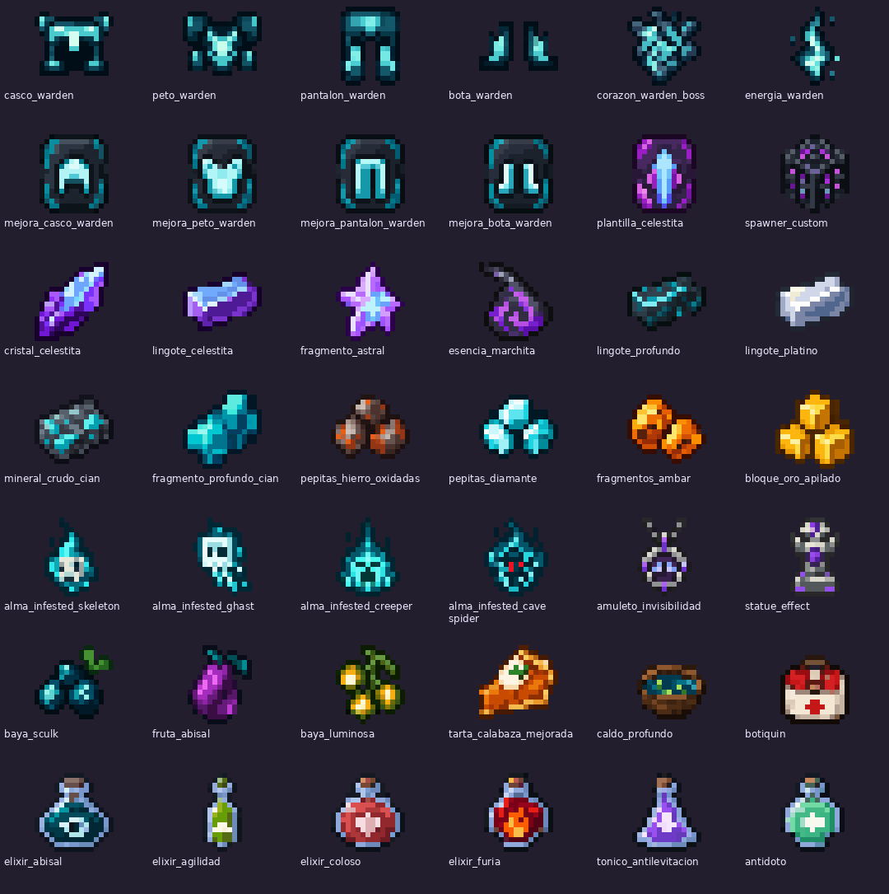
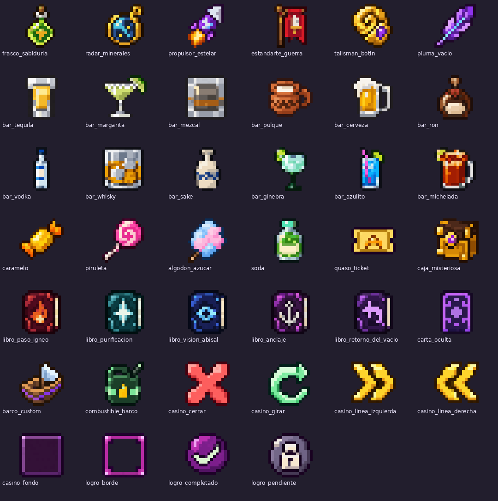
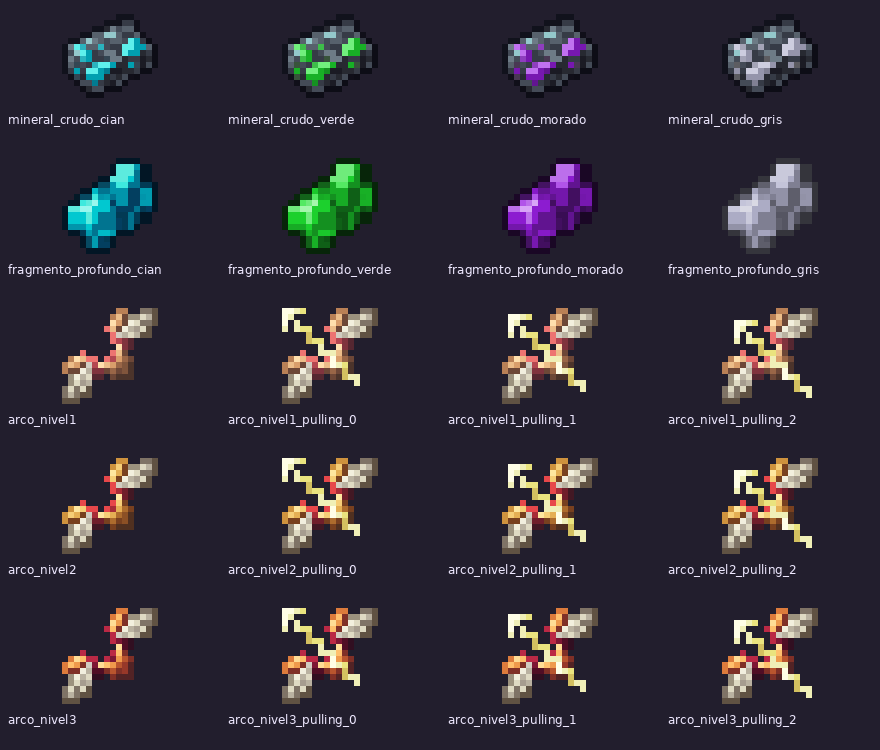
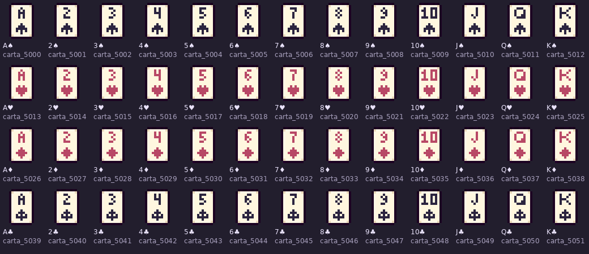
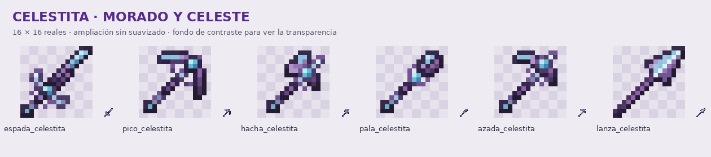

# Items de QuasoPlugin · pixel art 16×16

**Rama 26.2 · Lote completo a partir de tus texturas y referencias.**

Se completaron **143 identificadores que no tenían textura**: 82 items y materiales, 53 cartas —incluido el reverso— y ocho elementos de interfaz. Con las 131 texturas anteriores conservadas, esta carpeta cubre **274 modelos de item personalizados** que usa el plugin.

[Descargar ZIP](items-pixelart.zip) · [Catálogo de items](items-completados.md) · [Rutas y procedencia](catalogo-items.json)

**Tu estatua protectora `minecraft:statue_pr` conserva su modelo 3D.** No se incluye su atlas ni ningún JSON o PNG que lo reemplace. El otro item, `statue_effect`, sí tiene su propio icono de inventario.

## Nuevas texturas

## Contenido

| Archivo | Cantidad |
| --- | ---: |
| Definiciones `assets/minecraft/items/*.json` | 274 |
| Modelos `assets/minecraft/models/item/custom/*.json` | 287 |
| PNG de 16×16 | 284 |
| Tiras animadas originales de 16×96 | 2 |
| Textura de lanza en mano de 32×32 | 1 |
| Metadatos de animación `.png.mcmeta` | 2 |

Los 143 iconos nuevos y los nueve cuadros adicionales de los arcos explosivos son PNG RGBA de **16×16 reales**, con transparencia binaria, bordes sin suavizar y un máximo de 24 colores opacos. Los cuadros auxiliares explican por qué hay más PNG/modelos que identificadores de item.

Las texturas que ya tenías se conservan, incluidas las animaciones de `rep_hierro` y `rep_oro`. También se mantienen los 24 items y las seis herramientas de celestita de la revisión anterior. El Warden Gun incluye la corrección previa de orientación. Los cinco modelos vanilla que usa el plugin quedan a cargo de Minecraft.

## Herramientas, arcos y lanza

Las herramientas de celestita conservan las siluetas de 16×16 de tus referencias **twisted**, con tonos morados y cantos celestes. Esta ampliación no vuelve a redibujarlas.

El arco de hielo y los tres niveles de arco explosivo incluyen reposo y tres fases de tensado. Sus definiciones usan `minecraft:using_item` y los umbrales de `minecraft:use_duration` de vanilla 26.2. Los arcos explosivos conservan la geometría y las flechas de los ejemplos `arcane_bow`, con una paleta distinta por nivel.

La lanza de celestita mantiene un icono de inventario de 16×16 y una textura alargada de 32×32 para la mano, mediante `minecraft:display_context` y `minecraft:item/spear_in_hand`.

La armadura Warden de este lote son iconos de inventario: no sustituye las texturas de la armadura equipada en el jugador.

## Instalar

1. Descarga y descomprime **items-pixelart.zip**.
2. Fusiona su carpeta **assets** con la de tu resource pack. Copia los PNG, los JSON y los dos `.png.mcmeta`.
3. Conserva tu `pack.mcmeta`, tu modelo 3D de `statue_pr` y los demás archivos de tu pack.
4. Recarga con **F3 + T**. Si distribuyes el pack desde el servidor, actualiza su ZIP y su hash.

Esta carpeta es un complemento para tu pack de **26.2**, no un pack autónomo. El cambio solo añade recursos descargables: no modifica el código Java ni los comandos. `gancho` apunta a tu textura `gancho_2d`; `ficha_mision` y las cinco mochilas mantienen sus identificadores actuales.

## Verificación

Se comprobaron la cobertura de los identificadores del plugin, los tamaños y transparencia de los PNG nuevos, las referencias de todos los JSON, las 52 cartas distintas en el orden del código, los estados de los arcos y la integridad del ZIP. Las texturas anteriores se contrastaron con sus originales y los recursos de celestita de la revisión anterior permanecen intactos.

Se revisaron visualmente las hojas ampliadas sin suavizado. No se ejecutó un cliente de Minecraft para comprobar el aspecto en juego.
