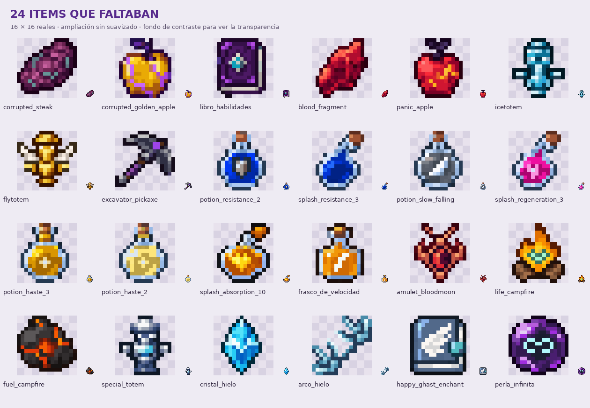
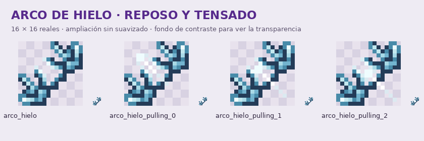

# Items pendientes y celestita · pixel art

**Rama 26.2 · Lote basado en tus dos RAR.**

Incluye los **24 items que faltaban de los 30 anteriores** y una nueva versión de las **seis herramientas de celestita**. Los archivos que ya tenías en `itemsyahechos.rar` no se reemplazan; las seis texturas de celestita sí llevan esta revisión.

[Descargar ZIP](items-pixelart.zip) · [Lista de items y modelos](items-completados.md)

## Estilo y tamaños

- Contornos de un píxel, colores planos, sin suavizado, paletas reducidas y transparencia binaria.
- Las cinco herramientas principales de celestita adaptan las siluetas **twisted** del RAR de ejemplos. Conservan su rejilla original de 16×16 y usan tonos morados, cantos celestes y mangos oscuros. La lanza adapta tu icono de lanza a la misma paleta.
- Hay **33 PNG de 16×16**: 24 items nuevos, seis herramientas y tres fases adicionales del arco. No son imágenes grandes renombradas.
- La única textura de **32×32** es `lanza_celestita_in_hand.png`: mantiene la silueta alargada y orientación nativa de la lanza de Minecraft 26.2, con la nueva paleta. El icono del inventario es de 16×16.
- La revisión parte de tus referencias. No se incluyen los RAR completos ni se añaden sus otros items al plugin.

## Arco y lanza

El arco de hielo incluye reposo y tres fases de tensado, con las posiciones de las flechas de la referencia `pale_bow`. Su JSON usa la condición `minecraft:using_item` y los umbrales de tensado de vanilla 26.2, apuntando a los modelos propios. Tanto el arco del Iceologer como la versión para jugadores comparten `minecraft:arco_hielo`.

La lanza usa `minecraft:display_context`: icono corto en inventario/suelo/marco/estante, y textura larga en la mano. Conserva `minecraft:item/spear_in_hand` y `swap_animation_scale: 1.95`.

## Instalar

1. Descomprime **items-pixelart.zip**.
2. Fusiona su carpeta **assets** con la de tu resource pack. Reemplaza los archivos de celestita y conserva los demás archivos que ya tenías.
3. Copia también los **JSON**: hay 30 definiciones de item y 34 modelos, incluidos los estados auxiliares del arco y la lanza.
4. Mantén tu `pack.mcmeta` y recarga con **F3 + T**. Si distribuyes el pack desde el servidor, actualiza su ZIP y su hash.

Esta carpeta es un complemento para tu pack existente, no un pack autónomo. No necesita cambios de Java ni nuevos nombres en los comandos. Las correcciones previas del Warden Gun no se modifican.

## Comprobaciones

PNG revisados a su tamaño real y ampliados sin suavizado; tamaños, transparencia, conservación de siluetas, referencias JSON y contenido del ZIP verificados. Las definiciones del arco y la lanza se contrastaron con los assets de Minecraft 26.2. No se ha ejecutado un cliente de Minecraft para comprobar el aspecto en la mano.
