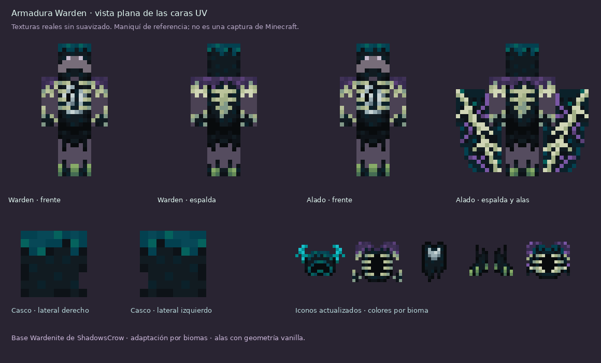
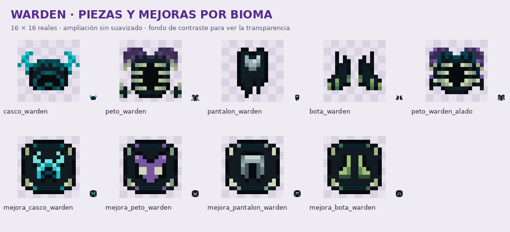
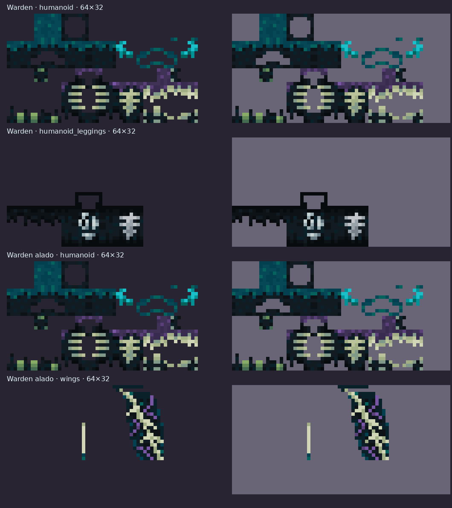

# Armadura Warden · sculk y biomas

**Rama 26.2 · Revisión #62.** Rediseño basado en **Wardenite Armor V1.5 (1.21 Ver.)**, el pack que aportaste, acreditado a **ShadowsCrow** en su `pack.mcmeta`.

[Descargar armadura, iconos y mejoras](armadura-warden.zip) · [Pack completo](items-pixelart.zip)

## Una base, cuatro biomas

Se conservan el dibujo, la distribución de sombras, las costillas claras y la base sculk oscura de la referencia. Los colores del bioma se concentran en sus refuerzos; no se reparten puntos de muchos colores por toda la armadura.

| Pieza | Bioma | Detalles |
| --- | --- | --- |
| Casco | Caverna Sculk / Deep Dark | Cian original del pack, sin recolorear |
| Peto | Abismo Flotante | Hombros y refuerzos morados, costillas de hueso |
| Pantalones | Ruinas de Ceniza | Cinturón y relieves gris ceniza |
| Botas | Pantano Profundo | Punteras y refuerzos verdes |
| Peto alado | Abismo Flotante | Mismo torso morado; alas sculk con nervaduras de hueso y acentos morados |

Los **cinco iconos de armadura** y las **cuatro mejoras** usan los mismos colores y motivos. Las mejoras son tablillas oscuras con esquinas de hueso y el símbolo de su pieza, con simetría horizontal exacta.

## Capas de la armadura

Los atlas son PNG RGBA **64×32**, sin suavizado y con transparencia binaria. Se conserva el mapa UV y la máscara de las capas de Wardenite. Las alas mantienen la máscara UV de las élitras vanilla. Los huecos de la referencia forman parte del diseño y permiten ver la skin o la capa interior.

| Archivo bajo `assets/minecraft/` | Uso |
| --- | --- |
| `textures/entity/equipment/humanoid/warden.png` | Casco, torso, brazos y botas |
| `textures/entity/equipment/humanoid_leggings/warden.png` | Pantalones y cintura |
| `textures/entity/equipment/humanoid/warden_alado.png` | Mismo torso y brazos para el peto alado |
| `textures/entity/equipment/wings/warden_alado.png` | Alas sculk |
| `equipment/warden.json` | Enlace de las dos capas normales |
| `equipment/warden_alado.json` | Enlace del peto y las alas |

Es una armadura **2D sobre la geometría vanilla**. Una textura no añade antenas que sobresalgan del casco. Las alas usan la geometría y animación normales de las élitras. No requiere shaders ni texturas emisivas.

## Instalar

1. Descomprime **armadura-warden.zip** y fusiona **assets** con tu resource pack, reemplazando las versiones anteriores. Este ZIP incluye los nueve iconos, sus JSON y las texturas de equipo; el ZIP completo contiene lo mismo.
2. Conserva el `pack.mcmeta` de tu pack de 26.2. Los archivos se llaman `warden` y `warden_alado`: no reemplazan la armadura de netherita vanilla.
3. Recarga con **F3 + T**. Si distribuyes el pack desde el servidor, actualiza su ZIP y hash.
4. Usa QuasoPlugin **#60 o posterior**, que ya enlaza las piezas con los modelos de equipo. No hace falta cambiar comandos ni recrear los items por este rediseño.

Se mantienen `casco_warden`, `peto_warden`, `pantalon_warden`, `bota_warden`, `peto_warden_alado` y las cuatro claves `mejora_*_warden`. Los iconos son **16×16 reales**. Los items antiguos conservan sus datos y se enlazan al equipar o entrar, como en #60.

## Procedencia y comprobaciones

Las cuatro piezas normales adaptan las texturas e iconos de Wardenite de ShadowsCrow proporcionados por el usuario. El casco conserva sus píxeles originales; las otras piezas mantienen sus formas y grupos de sombreado con la paleta del bioma. Las alas, el icono alado y las nuevas tablillas de mejora se diseñaron para acompañar ese conjunto.

Se verificaron dimensiones, transparencia binaria, máscaras UV, simetría de las mejoras, nombres y referencias de los JSON, y contenido de los dos ZIP. Los demás recursos del pack permanecen intactos. Esta revisión solo cambia recursos y documentación; no modifica Java.

Las vistas son montajes de las caras UV reales sobre un maniquí, no capturas del juego. Queda pendiente comprobar el aspecto en un cliente de Minecraft.
