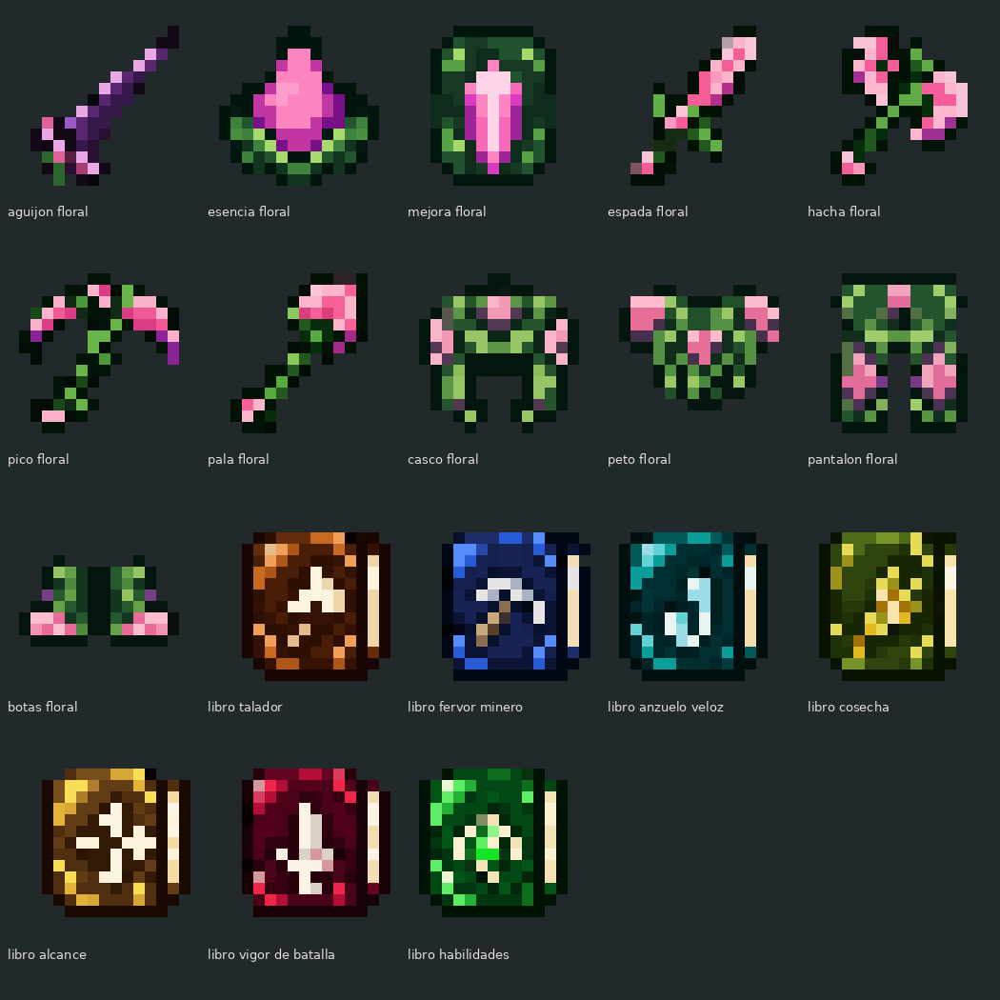
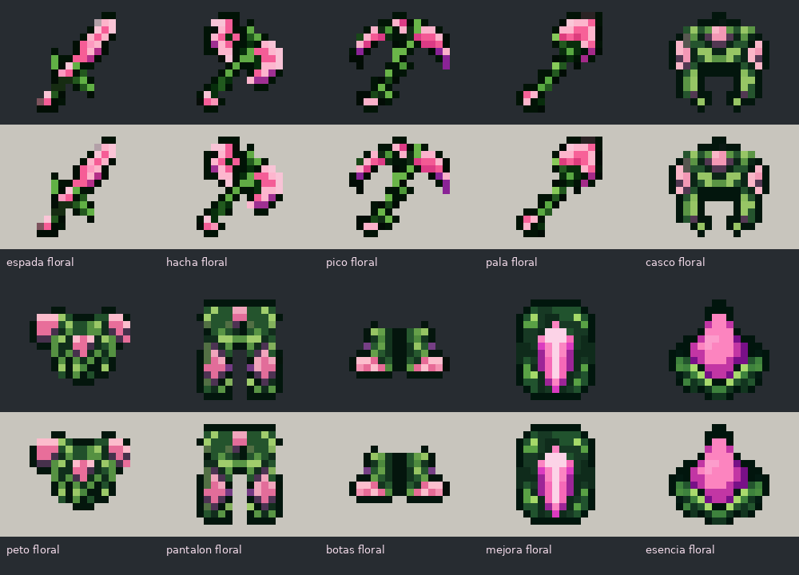
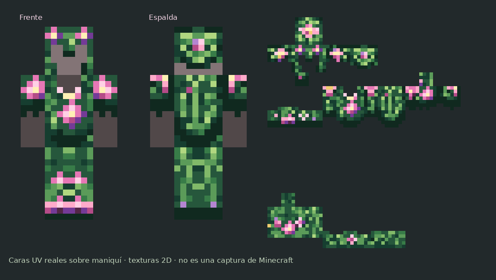

# Equipo floral y libros · 26.2

[Descargar el conjunto](equipo-floral.zip) · [Ver los iconos](vista_items.png) · [Ver la armadura](vista_armadura.png)

Rediseño para los items añadidos en **#66**, con texturas propias en **#67** y revisión de siluetas en **#70**. Los 18 iconos son PNG **16×16 reales**, con transparencia binaria y ampliación sin suavizado. Conservan los identificadores que usa el plugin.

## Revisión #70: contornos y materiales

Se redibujaron las cuatro herramientas, los cuatro iconos de armadura, la esencia y la mejora. Un borde verde casi negro separa las siluetas del fondo; las zonas verdes, rosas y moradas se agrupan para que la forma se lea a 16×16.

La esencia es una gota rosa con sombra morada sostenida por dos hojas. La mejora sigue la plantilla de celestita: placa verde oscura, esquinas biseladas y flecha rosa central.

La armadura equipada y sus atlas conservan el diseño de #67. Los siete libros, incluido el de habilidades verde, y el aguijón también se conservan.

## Conjunto floral

Una misma familia de materiales: raíces y hojas verdes para la estructura, pétalos rosas para las superficies, espinas y sombras moradas, y pequeños centros claros de polen. Las flores se agrupan en puntos concretos, siguiendo las raíces, como en los mobs florales.

| Items | Modelos |
| --- | --- |
| Aguijón y esencia | `aguijon_floral`, `esencia_floral` |
| Plantilla de mejora | `mejora_floral` |
| Herramientas | `espada_floral`, `hacha_floral`, `pico_floral`, `pala_floral` |
| Armadura | `casco_floral`, `peto_floral`, `pantalon_floral`, `botas_floral` |

La espada tiene una hoja curva; el hacha, dos filos de pétalos; el pico, extremos de espina; y la pala, una hoja puntiaguda. Son siluetas nuevas, no herramientas de netherita recoloreadas. La mejora tiene forma de plantilla con una flecha central.

## Armadura equipada

`equipment/floral.json` enlaza **dos texturas superpuestas** en cada tipo de equipo:

- `textures/entity/equipment/humanoid/floral.png`: raíces del casco, peto, brazos y botas.
- `textures/entity/equipment/humanoid/floral_flores.png`: pétalos, flores y polen de esas piezas.
- `textures/entity/equipment/humanoid_leggings/floral.png`: raíces y hojas del pantalón.
- `textures/entity/equipment/humanoid_leggings/floral_flores.png`: sus flores.

Los cuatro atlas son **64×32** con UV de armadura vanilla. La segunda textura separa la decoración floral de las raíces; las capas `humanoid` y `humanoid_leggings` corresponden a las distintas piezas, no a esa separación decorativa.

Es una armadura **2D sobre la geometría vanilla**. Los pétalos tienen sombreado, pero no sobresalen como los cubos de los mobs CEM. No necesita OptiFine, EMF ni shaders. La vista es un montaje de las caras UV reales sobre un maniquí, no una captura de Minecraft.

## Libros

Conservan el estilo de los libros anteriores: tapa oscura, esquinas iluminadas, páginas claras y un símbolo central sencillo.

| Encantamiento | Modelo | Tapa / símbolo |
| --- | --- | --- |
| Talador | `libro_talador` | Cobre y café / hacha |
| Fervor minero | `libro_fervor_minero` | Azul / pico |
| Anzuelo veloz | `libro_anzuelo_veloz` | Turquesa / anzuelo |
| Cosecha | `libro_cosecha` | Verde oliva / espiga |
| Alcance | `libro_alcance` | Dorado / flechas hacia fuera |
| Vigor de batalla | `libro_vigor_de_batalla` | Granate / espada |
| Habilidades | `libro_habilidades` | **Verde esmeralda** / gema verde |

## Instalar

1. Descomprime `equipo-floral.zip` y fusiona su carpeta **assets** con tu resource pack, aceptando los reemplazos. Incluye los JSON de los 18 items y el equipo floral.
2. Conserva el `pack.mcmeta` de tu pack de 26.2. Este ZIP es un complemento, no un pack independiente.
3. Instálalo después de los paquetes antiguos de `descargas`, para que no reaparezcan el libro morado o las texturas florales anteriores.
4. Recarga con **F3 + T**. Si lo distribuyes desde el servidor, actualiza el ZIP y su hash.

`resourcepack/assets` contiene una copia idéntica de estos recursos. QuasoPlugin #66 ya asigna `minecraft:floral` a la armadura y los modelos correctos a los items, por lo que esta revisión no necesita cambios de Java ni recrear los objetos.

## Comprobaciones

Revisados tamaños, transparencia, correspondencia entre JSON y PNG, conservación de los atlas de armadura y los otros ocho iconos, y contenido del ZIP. También se revisaron los contornos sobre fondos claro y oscuro. Pendiente comprobar el aspecto final en un cliente de Minecraft, especialmente con el brillo de los encantamientos activo.
