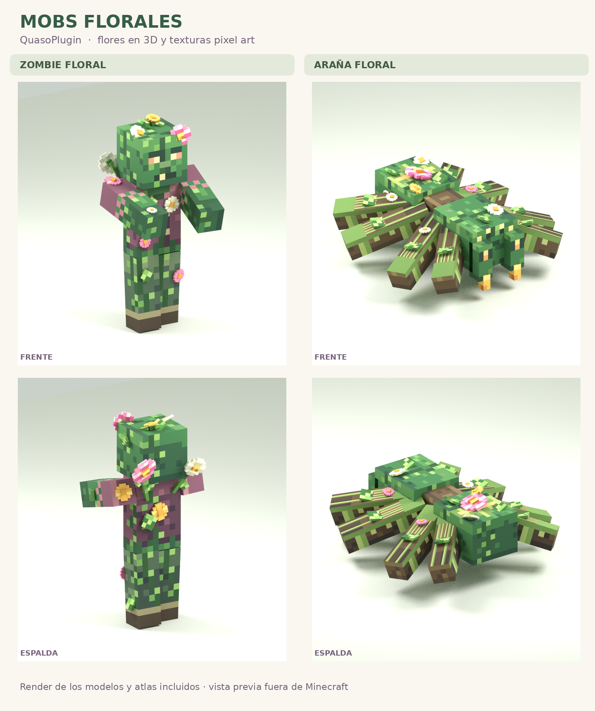
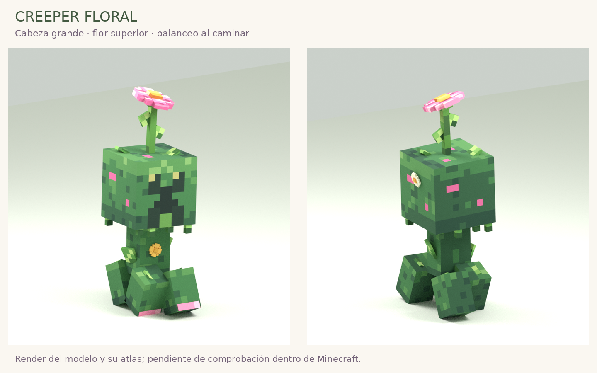
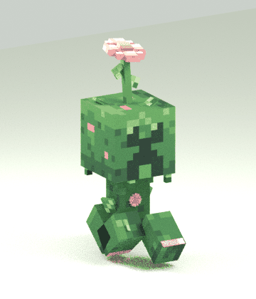
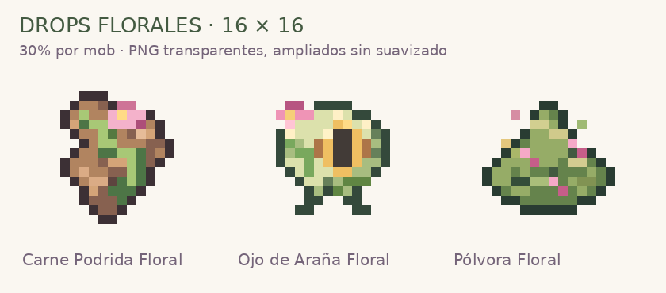

# Mobs florales y sus drops 🌸

Modelos **CEM con flores en 3D**, enredaderas y texturas de musgo. El zombi y la araña parten de los modelos corruptos de Blockbench que enviaste; el creeper sigue la referencia de cabeza grande y flor superior. Las flores acompañan el movimiento de la parte del cuerpo a la que están unidas.

[**Descargar modelos, texturas y reglas en ZIP**](https://github.com/CrissyjuanxD/QuasoPlugin/raw/refs/heads/26.2/descargas/mobs-florales/mobs_florales.zip) · [Texturas de monedas](../monedas-16x16/)







El creeper anima las cuatro patas y añade un balanceo suave de cuerpo, cabeza y tallo al caminar. La cabeza conserva el giro de mirada normal. El balanceo adicional se detiene cuando deja de andar. El GIF representa las expresiones del `.jem` evaluadas fuera del cliente.

La imagen muestra un render de los archivos incluidos sobre fondo claro. Las poses son de presentación; en Minecraft las anima el cliente. Los atlas PNG son de **128 × 128 píxeles**, con detalles pixel art sin suavizado. El tamaño del atlas permite distribuir las caras del cuerpo y las flores; no es el formato de 16 × 16 usado para los items de monedas.

## Qué incluye

| Mob | Modelo floral | Textura | Nombre que activa la variante |
| --- | --- | --- | --- |
| Zombie Floral | [zombie2.jem](assets/minecraft/optifine/cem/zombie2.jem) | [zombie2.png](assets/minecraft/optifine/random/entity/zombie/zombie2.png) | `Zombie Floral` |
| Araña Floral | [spider2.jem](assets/minecraft/optifine/cem/spider2.jem) | [spider2.png](assets/minecraft/optifine/random/entity/spider/spider2.png) | `Spider Floral` o `Araña Floral` |
| Creeper Floral | [creeper2.jem](assets/minecraft/optifine/cem/creeper2.jem) | [creeper2.png](assets/minecraft/optifine/random/entity/creeper/creeper2.png) | `Creeper Floral` |

- **Zombi:** corona de flores, flores en el pecho, hombros y rodilla, hojas y un ramo en la espalda.
- **Araña:** cuerpo y patas anchas basados en la referencia, flores en el abdomen, cabeza y patas, hojas y ojos dorados. Incluye `spider_eyes2.png` para la capa de los ojos.
- Se conservan los nombres de las partes y los puntos de unión de los modelos de referencia para heredar las animaciones del mob.
- **Creeper:** cabeza grande con flecos, hojas, flor superior y pétalos en los pies. Conserva la velocidad, tamaño reducido y explosión de la antigua Bombita.

## Drops de 16 × 16



Cada mob tiene **un 30% por muerte** de soltar una unidad de su item floral, además de sus drops normales. No cambia con Saqueo. El plugin identifica a los mobs mediante sus datos internos; renombrar un mob normal no le da estos drops.

| Mob | Item | `/giveqp` e identificador del modelo | PNG |
| --- | --- | --- | --- |
| Zombie Floral | Carne Podrida Floral | `carne_podrida_floral` | [Descargar](assets/minecraft/textures/item/custom/carne_podrida_floral.png) |
| Spider Floral | Ojo de Araña Floral | `ojo_arana_floral` | [Descargar](assets/minecraft/textures/item/custom/ojo_arana_floral.png) |
| Creeper Floral | Pólvora Floral | `polvora_floral` | [Descargar](assets/minecraft/textures/item/custom/polvora_floral.png) |

Los PNG tienen fondo transparente y **16 × 16 píxeles reales**. El ZIP incluye sus definiciones en `assets/minecraft/items` y modelos en `assets/minecraft/models/item/custom`, con el namespace `minecraft`. También están incorporados en la carpeta `resourcepack` del repositorio.

## Instalación

1. Descarga y descomprime el ZIP.
2. Copia **`assets`** dentro de tu resource pack, al lado de su `pack.mcmeta`. Es un complemento para tu pack; el ZIP no es un pack independiente.
3. Usa **Entity Model Features (EMF) + Entity Texture Features (ETF)**, o **OptiFine** con *Custom Entity Models* y *Random Entities* activados. Debe existir una versión compatible de esos mods con tu cliente. Minecraft sin esos mods no interpreta archivos `.jem`.
4. Activa el pack y recarga los recursos con **F3 + T**.
5. Actualiza QuasoPlugin y, con permisos de administración, crea ejemplares nuevos con `/spawnqp zombiefloral`, `/spawnqp spiderfloral` y `/spawnqp creeperfloral`. `/spawnqp abejafloral` es el nombre actualizado de la abeja. `aranafloral` también funciona como alias de la araña.

Los nombres antiguos `corruptedzombie`, `corruptedspider`, `bombita` y `queenbee` siguen aceptándose para que tus comandos y spawners existentes funcionen. Las Bombitas cargadas se renombran a Creeper Floral. Para ver o recibir todos los items desde un menú, usa **`/giveqp` sin argumentos**: clic para recibir uno, flechas para cambiar de página y barrera para cerrar. Conserva el permiso administrativo del comando.

Las reglas reconocen los nombres que asigna actualmente QuasoPlugin, incluidos los prefijos de color. No hace falta que el nombre se vea encima del mob. Un mob antiguo que todavía se llame `Corrupted Zombie` o `Corrupted Spider` no coincide con estas reglas: genera uno nuevo para comprobarlo.

## Por qué hay varios `.properties`

```text
assets/minecraft/optifine/
├── cem/
│   ├── zombie.jem            ← base vanilla, sin partes reemplazadas
│   ├── zombie2.jem           ← modelo floral
│   ├── zombie.properties    ← selecciona MODELOS
│   ├── spider.jem            ← base vanilla, sin partes reemplazadas
│   ├── spider2.jem           ← modelo floral
│   ├── spider.properties    ← selecciona MODELOS
│   ├── creeper.jem          ← base vanilla
│   ├── creeper2.jem         ← modelo floral y animaciones
│   └── creeper.properties  ← selecciona MODELOS
└── random/entity/
    ├── zombie/
    │   ├── zombie2.png
    │   └── zombie.properties ← selecciona TEXTURAS
    ├── spider/
    │   ├── spider2.png
    │   ├── spider_eyes2.png
    │   └── spider.properties ← selecciona TEXTURAS, incluida la capa de ojos
    └── creeper/
        ├── creeper2.png
        └── creeper.properties ← selecciona TEXTURAS
```

**El modelo del zombi floral es `zombie2.jem`.** Los archivos sin número contienen `"models": []`: proporcionan la base sin modificar las partes del modelo vanilla. La regla de nombre selecciona la variante **2**; la última regla reserva la variante **1** para los demás mobs.

Los `.properties` de `cem` usan `models`; los de `random/entity` usan `skins`. Tienen nombres iguales pero funciones y carpetas diferentes: conserva las rutas del ZIP.

### Si tu pack ya tiene otras variantes

Combina las reglas antes de reemplazar tus `.properties`. Este complemento ocupa la variante **2**, igual que la referencia, y no incluye la variante **3** de la araña infernal. Para conservar esa variante en tu pack, mantén sus modelos y texturas y añade su regla **antes de la regla final que selecciona 1**, tanto en modelos como en texturas. No copies una regla que apunte a un archivo que no tienes.

## Edición y comprobación

Los `.jem` se pueden importar con las herramientas CEM de Blockbench. Sus grupos tienen nombres como `corona_rosa`, `flor_pecho`, `rosa_abdomen`, `flor_pata_1` y `tallo_flor` para localizar las flores. Los tres modelos apuntan explícitamente al PNG de su carpeta `random/entity`. Las expresiones de movimiento del creeper están en `animations`, dentro de la parte `head`.

Se han comprobado la estructura JSON, las rutas, las coordenadas UV, las partes de los modelos y las reglas de selección; también se han renderizado la geometría y los atlas incluidos. **Pendiente de comprobación dentro de Minecraft con EMF/ETF u OptiFine**: el render no sustituye esa prueba del cliente.
