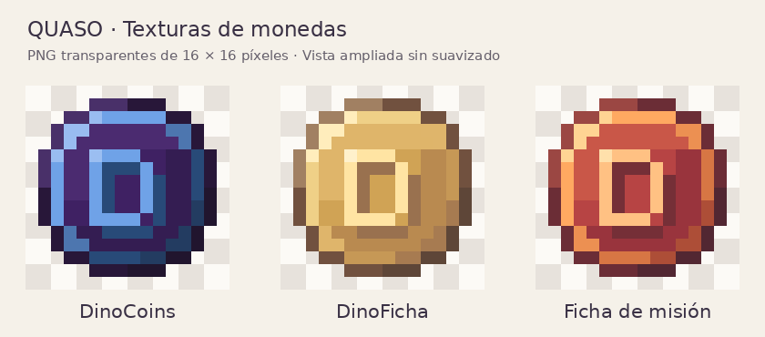

# Texturas de monedas · 16 × 16

[Descargar los tres PNG en ZIP](https://github.com/CrissyjuanxD/QuasoPlugin/raw/refs/heads/26.2/descargas/monedas-16x16/texturas_monedas_16x16.zip)

Los tres PNG tienen **16 × 16 píxeles reales**, fondo transparente y una **D** central. La vista previa está ampliada sin suavizado sobre un fondo claro; ese fondo no forma parte de las texturas.

- [DinoCoins](dinocoins.png): morado `#3f2163`, azul `#284a78` y letra `#6fa2e7`.
- [DinoFicha](dinofichas.png): amarillo dorado y café pastel.
- [Ficha de misión](ficha_mision.png): rojo y naranja.

Esta carpeta contiene las descargas por separado. Para descargar un PNG individual, abre su archivo y pulsa **Download raw file**.
