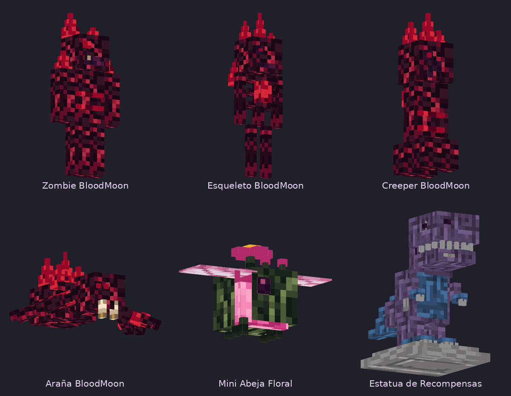
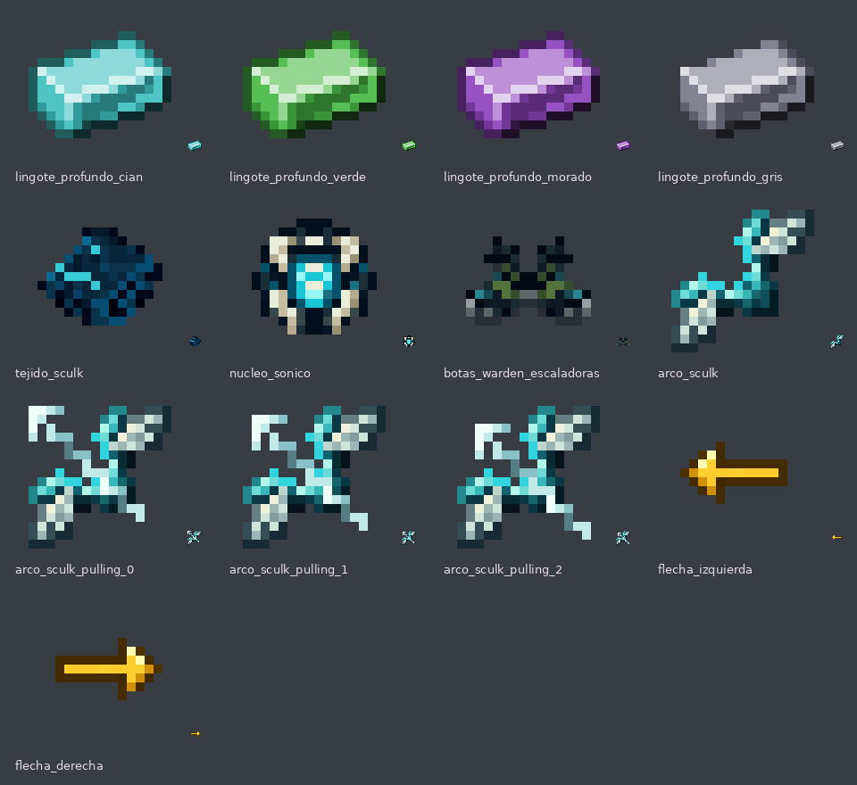

# BloodMoon, mini abeja floral e items nuevos

**QuasoPlugin · rama 26.2**

[Descargar los recursos](novedades-bloodmoon.zip) · [Ver los items](vista_items.png) · [Ver los modelos](vista_modelos.png) · [Visor 3D](vista_modelos.html)

Complemento para tu resource pack: fusiona la carpeta **assets** con la de tu pack y conserva tu `pack.mcmeta`. Los mismos recursos están copiados en `resourcepack/assets` del repositorio.



## Mobs de BloodMoon

Los cuatro usan granate y rojo oscuro, con cristales rojos en relieve inspirados en el fragmento de BloodMoon. Los **cristales y los ojos son emisivos**: permanecen iluminados en la oscuridad. Esa emisión no proyecta luz real sobre los bloques y no necesita shaders; un halo de bloom depende del shader del jugador.

| Mob | Modelo | Detalles |
| --- | --- | --- |
| Zombie BloodMoon | `zombie4.jem` | Corona, hombros y espalda con cristales, ojos rojos y dientes |
| Esqueleto BloodMoon | `skeleton4.jem` | Costillas separadas, núcleo rojo en el pecho y corona de cristales |
| Creeper BloodMoon | `creeper4.jem` | Cristales en la cabeza y espalda, ojos rojos y marcas en el torso |
| Araña BloodMoon | `spider4.jem` | Cuatro ojos, colmillos, cristales dorsales y detalles en las patas |

Los selectores `.properties` usan los nombres reales del plugin. Se conserva la variante floral **2**, la variante Warden **3** cuando existe y el modelo vanilla **1** para los demás. Los mobs mantienen sus partes móviles normales. La armadura equipada por el plugin puede cubrir parte de la piel del zombie o el esqueleto; no se cambian estadísticas, equipamiento, ataques ni recompensas.

El atlas de los modelos nuevos es `assets/minecraft/optifine/cem/quaso99/materiales.png`, de 64×64. Su pareja `materiales_e.png` solo ilumina el material rojo usado por cristales y ojos.

### Corrección de selectores · revisión #100

El lote #99 omitía los `.properties` de `random/entity` correspondientes a las texturas florales y Warden incluidas. Eso permitía que OptiFine seleccionara esas texturas al azar para mobs normales. Esta revisión incluye las reglas de zombie, esqueleto, creeper y araña, todas con selección por nombre y retorno explícito a la textura vanilla.

Son dos selecciones distintas: **`cem/*.properties` elige el modelo** y **`random/entity/.../*.properties` elige las texturas aleatorias**. Los JEM de BloodMoon, la mini abeja y la estatua ya declaran directamente `materiales.png`; ese atlas no necesita un selector en `random`. No se añade una skin BloodMoon al UV vanilla porque sus coordenadas no coinciden con las de los modelos nuevos.

La araña incorpora además `spider_eyes.properties`: conserva los ojos florales existentes, mantiene los ojos vanilla para las arañas normales y utiliza una capa transparente para la araña BloodMoon. Sus ojos y cristales se iluminan mediante `materiales_e.png`, evitando superponer la capa de ojos vanilla sobre otros elementos del modelo.

## Mini abeja y estatua

- **Mini Abeja Floral:** cuerpo con raíces verdes, bandas rosas, alas claras, antenas y una flor que sobresale del lomo. El plugin aumenta la escala de **0,8 a 1,2**, un 50 % respecto al tamaño anterior. Se actualizan también las abejas florales existentes al cargar, sin curarlas ni cambiar las abejas normales. Modelo **`bee3.jem`**.
- **Estatua de Recompensas:** dinosaurio morado y azul, boca abierta con dientes de piedra, cola, pequeñas garras y base gris. Los parches grises muestran la piedra bajo el color. Modelo `copper_golem2.jem`, seleccionado solo para el gólem llamado `Estatua de Recompensas`. Conserva la escala 2,0 y la interacción de recompensas del plugin.

**Reserva de la Abeja Floral:** `bee2.jem` pertenece al modelo que ya tiene el usuario. El ZIP no contiene ni reemplaza ese archivo. Conserva tu `assets/minecraft/optifine/cem/bee2.jem` original y todas sus texturas. El selector combinado aplica primero la mini abeja (3), después la Abeja Floral (2), y finalmente las abejas normales (1). Si ya instalaste el lote #99 y sobrescribiste tu `bee2.jem`, restaura tu original desde tu copia del pack; el anterior archivo de la mini abeja ahora se llama `bee3.jem`.

Los mobs requieren **EMF + ETF**, o una versión compatible de **OptiFine** con CEM, modelos por nombre y texturas emisivas activadas. El cliente y los mods deben soportar la versión utilizada; la estatua necesita además soporte CEM para el gólem de cobre. Minecraft vanilla conserva los modelos normales. Los items y las flechas sí usan el sistema vanilla de modelos de items.

## Items en 16×16



| Item | Identificador del modelo |
| --- | --- |
| Lingote profundo cian | `minecraft:lingote_profundo_cian` |
| Lingote profundo verde | `minecraft:lingote_profundo_verde` |
| Lingote profundo morado | `minecraft:lingote_profundo_morado` |
| Lingote profundo gris | `minecraft:lingote_profundo_gris` |
| Tejido sculk | `minecraft:tejido_sculk` |
| Núcleo sónico | `minecraft:nucleo_sonico` |
| Botas de warden escaladoras | `minecraft:botas_warden_escaladoras` |
| Arco sculk | `minecraft:arco_sculk` |
| Flecha dorada izquierda | `minecraft:flecha_izquierda` |
| Flecha dorada derecha | `minecraft:flecha_derecha` |

Los lingotes conservan la silueta y el sombreado del lingote profundo existente. El arco usa las cuatro posiciones del arco anterior con una paleta sculk, cian y hueso. Las botas cambian su icono; la armadura equipada conserva su modelo actual. Las flechas de misiones y habilidades usan las dos direcciones, sin brillo de encantamiento.

## Colocar tus tres iconos originales de misión

**Los tres PNG incluidos son papel vanilla provisional.** No se recrearon los iconos enviados en el chat. Los modelos y el código ya están conectados; solo tienes que reemplazar estos archivos con tus imágenes originales de 16×16 y fondo transparente:

```text
assets/minecraft/textures/item/custom/mision_completada.png
assets/minecraft/textures/item/custom/mision_activa.png
assets/minecraft/textures/item/custom/mision_inactiva.png
```

En el repositorio están dentro de `descargas/novedades-bloodmoon/` y también en `resourcepack/`. Sustitúyelos en la carpeta que utilices para montar tu pack. `mision_inactiva.png` es el icono de misión no descubierta. Los espacios del menú que no contienen ninguna misión siguen siendo invisibles. No necesitas modificar los JSON ni recompilar para sustituir estas imágenes.

## Instalación y revisión

1. Actualiza y compila el plugin para recibir el tamaño nuevo de las abejas y los modelos de los menús.
2. Descomprime el ZIP y fusiona **assets** con tu resource pack, conservando tu **`bee2.jem` de la Abeja Floral y sus texturas**. Si ya instalaste el lote Warden Cave, coloca este lote después para conservar las reglas nuevas de BloodMoon. Si tienes selectores propios adicionales, integra sus reglas en los `.properties` combinados.
3. Reemplaza los tres iconos de misión indicados arriba.
4. Actualiza el ZIP y hash del pack del servidor; recarga los recursos del cliente con **F3 + T**.

El visor `vista_modelos.html` funciona sin conexión y permite girar los seis modelos. Las vistas usan la geometría y el atlas exportados, sin equipamiento ni iluminación emisiva del juego. Se verificaron las referencias, dimensiones, UV, selectores, emisión y ZIP; el plugin compiló y pasaron las ocho pruebas seleccionadas de misiones y abejas. **No se ejecutó un cliente de Minecraft con EMF/ETF**: queda pendiente comprobar allí las animaciones y la compatibilidad visual del gólem de cobre.

La revisión #100 solo cambia recursos y documentación; no requiere recompilar el plugin respecto a #99. `python validar_modelos.py` comprueba los once selectores del lote, las variantes referenciadas, los nombres con y sin color, los fallbacks vanilla y los tamaños de atlas. Detecta específicamente PNG numerados sin reglas, el fallo que faltó comprobar en #99. Informa de `bee2.jem` como recurso externo pendiente, porque el original del usuario no está disponible para validarlo aquí. Las comprobaciones estáticas no garantizan por sí solas el resultado visual en el cliente.

## Recursos conservados

Se incluyen las variantes florales y Warden existentes para no romper sus selectores. Las variantes Warden previas conservan la referencia a **Sculkified Mobs V2.0**, de **GillsBills**, aportado por el usuario; véase el README de `descargas/warden-cave-biomas`. El papel provisional corresponde a la textura vanilla de Minecraft. Los modelos nuevos, su atlas y los iconos nuevos se prepararon para este lote.
