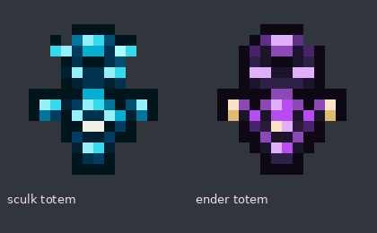

# Sculk Totem y Ender Totem · #71

[Descargar texturas y modelos](totems-sculk-ender.zip)



Los dos items usan el tótem vanilla como base: se consumen una vez al evitar una muerte. Renombrar un tótem normal no activa sus efectos especiales.

| Tótem | Efectos al activarse |
| --- | --- |
| **Sculk Totem** | Efectos vanilla y **Resistencia III durante 3 segundos** |
| **Ender Totem** | **Regeneración V 1:45**, **Absorción V 1:05**, **Resistencia al fuego IV 1:40** y **Resistencia V 0:05** |

Para Ender se suman **3 niveles y 60 segundos** a cada efecto vanilla (Regeneración II 0:45, Absorción II 0:05 y Resistencia al fuego I 0:40). La resistencia adicional dura cinco segundos.

## Obtenerlos

Con permisos para `/giveqp`:

```text
/giveqp sculk_totem
/giveqp ender_totem
```

También aparecen en el catálogo de `/giveqp` y en su autocompletado. No se añaden recetas ni recompensas nuevas.

## Texturas

PNG **16×16**, transparencia binaria y modelos `minecraft:sculk_totem` / `minecraft:ender_totem`. El Sculk tiene cuerpo oscuro, antenas y marcas cian; el Ender, obsidiana, ojos violetas y acentos claros.

Fusiona `assets` del ZIP con tu resource pack y conserva su `pack.mcmeta`. Recarga con **F3 + T** y actualiza el ZIP/hash del servidor cuando lo distribuyas. Las mismas copias están en `resourcepack/assets`.

## Funcionamiento y validación

Se identifica la mano consumida por `EntityResurrectEvent`. No se activan al cancelarse el evento ni por llevar el tótem en la otra mano. Los efectos se aplican un tick después, tras la limpieza vanilla, siempre que el jugador siga conectado y vivo. El consumo y la animación los realiza Minecraft.

Compilación y pruebas unitarias de activación, tiempos, niveles, cancelación, mano usada, desconexión, identidad y registro en `/giveqp`. No se ha comprobado esta revisión en un servidor con jugadores.
