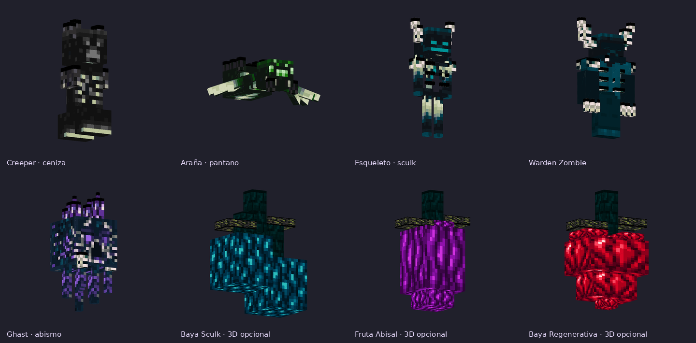
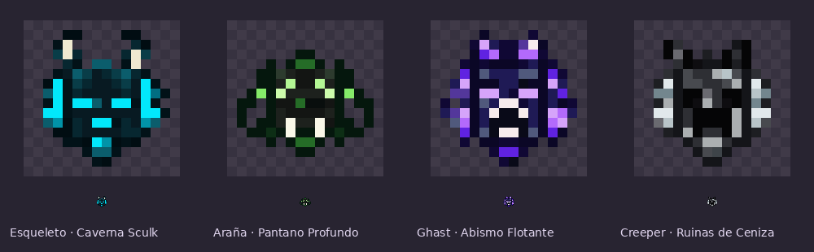
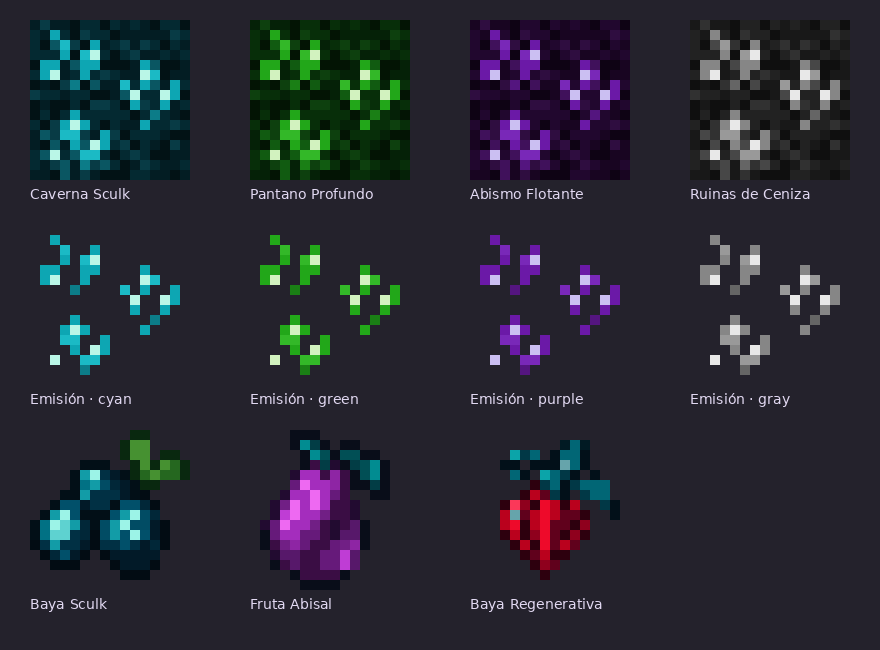

# Warden Cave · mobs, minerales y frutas

**QuasoPlugin · rama 26.2 · revisión #64**

[Descargar pack principal](warden-cave-biomas.zip) · [Frutas 3D opcionales](frutas-3d-opcional.zip) · [Visor 3D sin conexión](vista_modelos.html)

Carpeta independiente: no reemplaza las carpetas de las monedas, los mobs florales ni la armadura. Es un **complemento para tu resource pack**, no un pack autónomo: conserva tu `pack.mcmeta` de 26.2.

## Los cinco mobs

| Mob del plugin | Archivo CEM | Bioma / diseño |
| --- | --- | --- |
| Infested Creeper | `creeper3.jem` | Ruinas de Ceniza: sculk gris, coraza de basalto y corona rota |
| Infested Cave Spider | `cave_spider3.jem` | Pantano Profundo: verde, raíces, colmillos y brotes dorsales |
| Infested Skeleton | `skeleton3.jem` | Caverna Sculk: cian, antenas sólidas y costillas que sobresalen |
| Warden Zombie | `zombie3.jem` | Todos los biomas: visor ciego, mandíbula, antenas escalonadas, costillas, espina y manos largas con garras |
| Infested Ghast | `ghast3.jem` | Abismo Flotante: morado, corona de cristales, mandíbula y tentáculos sculk |

El «Infested Zombie» de esta petición corresponde al **Warden Zombie** que ya utiliza el plugin. El selector acepta ambos nombres. La araña del plugin es una **araña de cueva**; por eso su modelo se llama `cave_spider`, no `spider`.

Los modelos mantienen las partes estándar para seguir las animaciones normales de Minecraft. Los atlas nuevos son de **128×64**, con las zonas originales y un área adicional para los materiales de las piezas 3D. Las hitboxes y los ataques no cambian por el resource pack.

### Selección y convivencia con los florales

- La variante **3** se aplica por el nombre real del mob, incluso con el nombre oculto sobre la cabeza.
- La variante **2** de zombie, creeper y spider sigue reservada a los florales. Se incluyen sus archivos existentes para que los selectores combinados funcionen al fusionar este pack.
- El resto cae en la variante **1**, vanilla. No se copian las reglas aleatorias subterráneas ni el reemplazo global de mobs del pack de referencia.
- Si tu pack tiene más reglas propias para estos mismos mobs, integra los selectores `.properties` en vez de perder esas reglas al sustituir el archivo.

### Cambio del plugin

La revisión **#63** elimina el shrieker del casco al crear el Warden Zombie. También lo retira de los Warden Zombies antiguos al iniciar el sistema o cargar sus entidades; no retira cascos de zombies normales. Se conserva la armadura de cuero, las estadísticas y la lógica de combate. La vista previa no dibuja esa armadura equipada, que puede cubrir parte de la piel en el juego.

## Almas adaptadas a los modelos · #64

[Descargar solo las cuatro almas y sus JSON](almas-warden.zip)

Las cuatro almas del plugin ahora representan los nuevos mobs: esqueleto sculk con antenas cian, araña verde con raíces y colmillos, ghast morado con cristales y creeper gris con cuernos de basalto. Conservan un pequeño contorno espectral y sus identificadores `alma_infested_skeleton`, `alma_infested_cave_spider`, `alma_infested_ghast` y `alma_infested_creeper`.

Son PNG transparentes de **16×16**, con un máximo de 16 colores por icono. Se mantienen sus modelos y recetas. El plugin no tiene un item de alma de Warden Zombie; esta revisión actualiza las cuatro almas existentes.

## Cuatro minerales emisivos

| Bloque que usa el plugin | Textura | Color |
| --- | --- | --- |
| `cyan_glazed_terracotta` | `ore_cyan.png` | Cian |
| `lime_glazed_terracotta` | `ore_green.png` | Verde |
| `purple_glazed_terracotta` | `ore_purple.png` | Morado |
| `gray_glazed_terracotta` | `ore_gray.png` | Gris |

Son texturas estáticas de **16×16**, con fondo sculk oscuro inspirado en tus bloques y cristales agrupados. Cada mineral tiene su pareja **`_e.png`**: solo emiten los cristales, no la piedra completa. No tienen animación.

Las reglas CTM se limitan a `quaso:caverna_sculk`, `quaso:pantano_profundo`, `quaso:abismo_flotante` y `quaso:ruinas_de_ceniza`. El material colocado fuera de esos biomas conserva su textura habitual.

## Tres frutas

- **Baya Sculk:** piel cian para el `verdant_froglight` de Caverna Sculk, relacionada con su item.
- **Fruta Abisal:** piel morada para el `pearlescent_froglight` de Abismo Flotante.
- **Baya Regenerativa:** icono original rojo con forma de corazón, nervaduras y hojas sculk; reemplaza el diseño parecido a sweet berries. Las enredaderas con bayas de Pantano Profundo usan una textura relacionada.

El identificador de la Baya Regenerativa sigue siendo **`minecraft:baya_luminosa`**, para conservar recetas, datos y comandos existentes. Los tres iconos se incluyen con sus JSON y son de **16×16**.

### 3D opcional, como elegiste

El **pack principal solo cambia texturas de bloques por bioma**. No contiene sustituciones globales de blockstates.

El ZIP **frutas-3d-opcional.zip** añade tres modelos vanilla de frutas colgantes: racimo sculk, fruto abisal alargado y fruto rojo de dos lóbulos con punta; incluyen tallo y hojas. No necesita CEM para estos bloques.

**Ese complemento 3D sí cambia globalmente** el aspecto de los froglights verdes y perlados y de las enredaderas que tienen bayas, también fuera de Warden Cave. Las enredaderas sin bayas mantienen su modelo normal. No lo instales si quieres conservar todos esos bloques vanilla fuera de la dimensión. No modifica colisiones, iluminación ni drops: los froglights siguen teniendo colisión de bloque completo aunque el modelo de fruta sea más pequeño.

## Instalar

1. Descomprime **warden-cave-biomas.zip** y fusiona su carpeta **assets** con la de tu resource pack.
2. Aplica este lote **después** del pack de items anterior para que `baya_luminosa.png` sea la nueva baya roja y las cuatro almas usen sus nuevos rostros.
3. Conserva tu `pack.mcmeta`. Recarga con **F3 + T**, o actualiza el ZIP y hash del pack del servidor.
4. Compila e instala QuasoPlugin #63 para quitar los shriekers. Los recursos no eliminan por sí solos el bloque equipado.
5. Solo si deseas el cambio global de frutas, fusiona además **assets** del ZIP opcional.

### Soporte del cliente

Los mobs necesitan un cliente con **CEM y selección de texturas/modelos por nombre** (por ejemplo EMF + ETF, o una versión compatible de OptiFine). Los bloques por bioma y su emisión necesitan soporte **CTM y texturas emisivas**, como Continuity/OptiFine según el cliente. Comprueba que la versión de esos mods sea compatible con tu Minecraft. El archivo `optifine/emissive.properties` usa el sufijo `_e`.

**Minecraft vanilla no interpreta CEM ni CTM**: sin ese soporte verás los mobs y los bloques habituales. El nuevo icono de baya y el complemento de frutas 3D sí usan recursos vanilla. Las texturas emisivas se ven iluminadas; no proyectan luz real sobre bloques vecinos.

## Vistas y comprobaciones

- `vista_modelos.html`: descarga y abre el archivo en el navegador; contiene sus texturas y funciona sin conexión. Permite girar los cinco mobs y las tres frutas.
- `vista_modelos.png`: montaje de ese visor, con geometría y texturas exportadas en reposo.
- `vista_texturas.png`: píxeles reales de los minerales, máscaras emisivas y frutas.

Se compiló Java 25 y se verificaron los JSON/JEM, dimensiones, máscaras de emisión, coordenadas UV, selectores por nombre, recursos referenciados e integridad de los ZIP. El visor cargó los ocho modelos sin errores de JavaScript ni texturas pendientes. **No se ejecutó un cliente de Minecraft con CEM/CTM**; las vistas no sustituyen esa comprobación de compatibilidad y animaciones en juego.

## Referencias

Base de zombie, creeper, esqueleto y araña: **Sculkified Mobs V2.0**, de **GillsBills**, según el `pack.mcmeta` del ZIP aportado. Se conservaron sus mapas UV y motivos sculk, adaptando los colores y añadiendo geometría 3D. El ghast y sus materiales se prepararon para este lote. Referencia de bloques: el RAR de texturas de bioma aportado por CrissyjuanxD.
